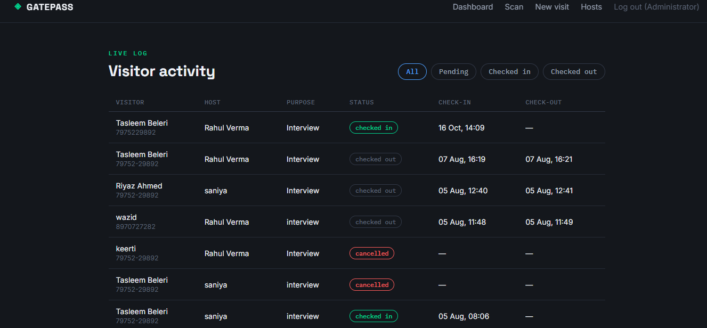
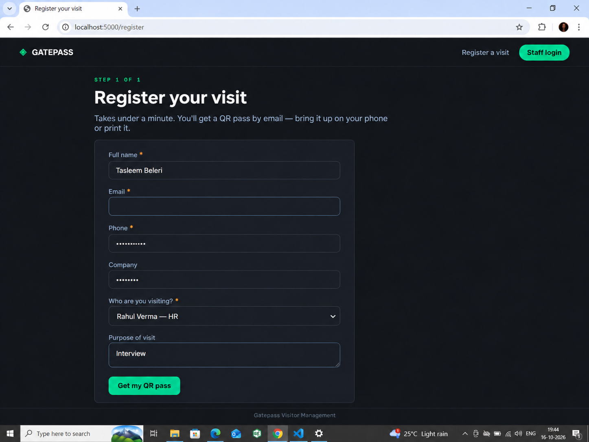
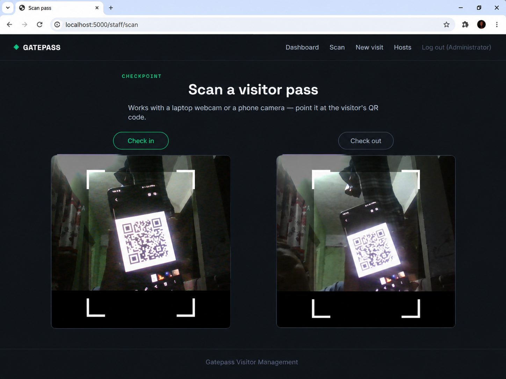
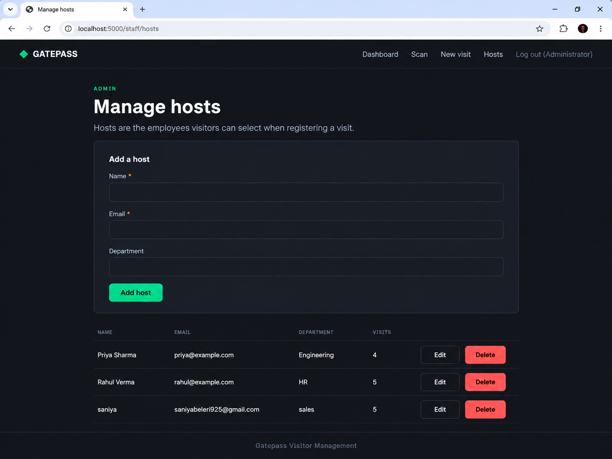

# QR Visitor Management System

A web-based visitor management application built with **Flask and MySQL** that helps manage visitor registrations and track entry and exit using QR codes.

## Overview

The QR Visitor Management System digitizes the visitor registration process, making it easier to maintain visitor records and manage visits through a web interface. It includes QR code generation and scanning functionality to support visitor check-in and check-out.

This project was developed to practice backend development, database integration, and web application development using Python.

## Screenshots

### Dashboard


### Visitor Registration


### QR Scanner


### Host Management


## Features

- **Visitor Registration:** Register visitors and maintain their visit details.
- **QR Code Generation:** Generate QR codes associated with visitor records.
- **QR Code Scanning:** Scan QR codes through the staff scanning interface.
- **Check-In and Check-Out:** Support visitor entry and exit tracking.
- **Host Management:** Manage host information for visitor coordination.
- **Database Integration:** Store and manage application data using MySQL.
- **Web Interface:** Use a browser-based interface built with HTML, CSS, and JavaScript.

## Tech Stack

| Technology | Purpose |
|---|---|
| Python | Backend programming |
| Flask | Web application framework |
| MySQL | Database |
| HTML | Page structure |
| CSS | Styling and layout |
| JavaScript | Client-side functionality |
| QR Code | Visitor identification and scanning |
| Git & GitHub | Version control |

## Project Structure

```text
QR_visitor_Managment/
├── app.py
├── config.py
├── extensions.py
├── models.py
├── requirements.txt
├── schema.sql
├── scripts/
│   └── init_db.py
├── static/
│   ├── css/
│   │   └── style.css
│   ├── js/
│   │   └── scanner.js
│   └── qrcodes/
├── templates/
│   ├── base.html
│   ├── dashboard.html
│   ├── home.html
│   ├── hosts.html
│   ├── register.html
│   ├── registration_success.html
│   ├── scan.html
│   ├── staff_login.html
│   └── staff_register_visit.html
└── utils/
    ├── email_utils.py
    ├── pdf_utils.py
    └── qr_utils.py
```

## Getting Started

### Prerequisites

Install the following before running the application:

- Python 3.10 or a compatible version
- MySQL Server
- Git

### 1. Clone the Repository

```bash
git clone https://github.com/tasleembeleri8-oss/QR_visitor_Managment.git
cd QR_visitor_Managment
```

### 2. Create a Virtual Environment

**Windows PowerShell:**

```powershell
python -m venv venv
.\venv\Scripts\Activate.ps1
```

### 3. Install Dependencies

```bash
pip install -r requirements.txt
```

### 4. Configure the Database

1. Start your MySQL server.
2. Create the database required by the application.
3. Configure the database connection using the settings expected by `config.py`.
4. Initialize the database schema using `schema.sql` or the project's database initialization script, as appropriate.

Keep database credentials and other sensitive configuration values out of source control.

### 5. Run the Application

```bash
python app.py
```

Open the local URL displayed in your terminal. If the application starts on the default Flask development address, visit:

```text
http://localhost:5000
```

For camera-based QR scanning, use `localhost` in the browser rather than an ordinary HTTP network IP address.

## Learning Outcomes

This project demonstrates practical experience with:

- Building web applications using Flask
- Connecting Python applications to MySQL
- Organizing application code into modules
- Implementing QR code generation and scanning
- Working with HTML, CSS, and JavaScript
- Managing project versions using Git and GitHub

## Future Enhancements

- Role-based access control and improved authentication
- Searchable visitor history and reporting
- Automated visitor notifications
- Deployment to a cloud platform
- Automated tests and continuous integration

## Author

**Tasleem**

Computer Science and Engineering Graduate | Aspiring Software Developer

[GitHub Profile](https://github.com/tasleembeleri8-oss)
